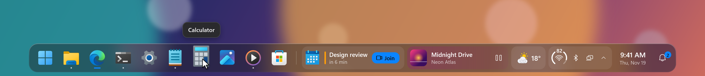
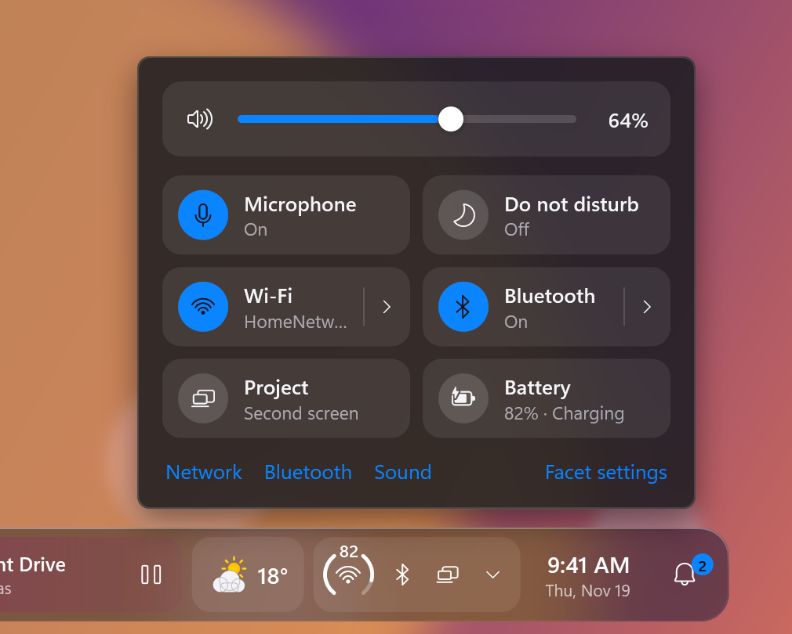
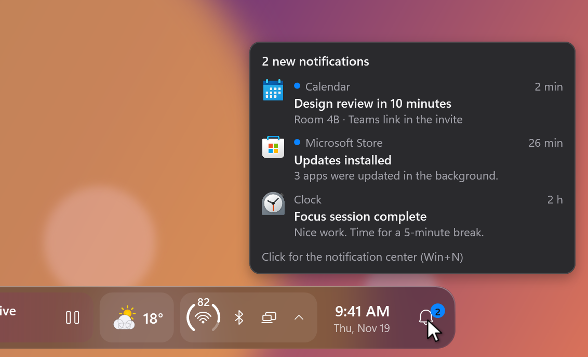
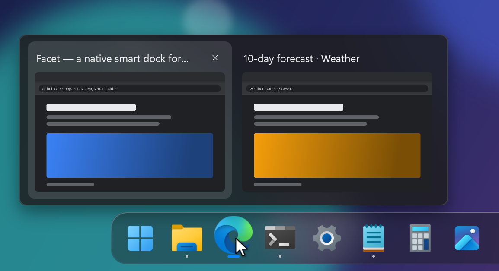
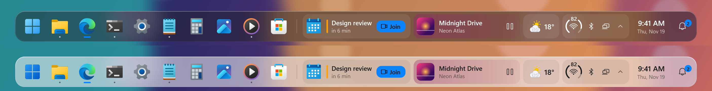

# Facet — a better taskbar for Windows

A see-through, macOS-style dock for Windows 10 and 11 that replaces (or floats above) the taskbar: your apps, live widgets and quick controls in one glass bar, with motion that feels native.
Built in C# / WPF on .NET 10. No web runtime, no account, no telemetry.



<sub>Screenshots are rendered from Facet's own UI with sample data.</sub>

## Highlights

| | |
|---|---|
|  | **Quick controls.** Wi-Fi inside a battery ring, Bluetooth, Project and an expand arrow for volume, microphone, do not disturb and more. Tiles switch things on and off; their **›** opens Windows' network or Bluetooth list. Choose which buttons the tile shows and in what order. |
|  | **Notification bell.** Opens Windows' notification center (Win+N), counts what's new since you last looked, previews the latest three on hover, and is crossed out while Windows' do not disturb is on. |
|  | **Live window previews.** Rest the pointer on a running app to see its windows live, like the taskbar. Click one to switch to it, × to close it. |



## Features

**Apps**
- Your real taskbar pins plus running apps, with running dots and an active-app line that glides from app to app.
- Icons near the pointer grow like the macOS dock; new apps slide in, closed ones slide out, and launching apps bounce until their window appears.
- Click to focus or minimize (with several windows, clicks cycle through them), middle-click for a new window, right-click for its windows, pin / unpin and close. Drop files on an icon to open them with that app.

**Widgets** (turn on, off and reorder in Settings → Widgets)
- **Up next:** the next event with a countdown, and a **Join** button when it's a Teams, Zoom, Meet or Webex call starting within 10 minutes.
- **Now playing:** any app using Windows media controls, tinted with the album art's colour.
- **Weather**, **Todos**, and opt-in **CPU & RAM rings** and a **Pomodoro** timer.
- **Custom widgets:** any shell command or URL (plus an optional JSON path) becomes a tile with its own refresh interval.
- **Clock** with a calendar panel: month grid, agenda, quick add and read-only iCal subscriptions (Google, Outlook, iCloud).

**Everything else**
- **Command palette** (`Ctrl+Alt+Space`, or the first free fallback such as `Win+Alt+Space`): apps, dock actions, `=` math, `>` shell commands, `todo …`, folders, URLs, `?` web search.
- **Smart alerts:** "Design review starts in 4 min — Pause music", low battery, CPU running hot, Pomodoro done; quiet hours and focus sessions hold them until they matter.
- **Hover tips** centred on each icon and widget: what it is, then what clicking or scrolling does.

## Look and behaviour

- **Glass:** live blur of whatever is behind the dock (apps, video, wallpaper) with a hairline of light along its top edge. Themes: Glass, Frosted, Midnight, Black, White, or follow Windows' light/dark mode. The accent follows your Windows accent colour.
- **Motion:** panels rise out of the dock and grow from what opened them, rings sweep to new values, the clock rolls over, the bell rings for a new notification. Every animation is short and only runs when something changes; they're off whenever Windows' "Animation effects" is, or with Settings → Appearance → Animations.
- **Layout:** sizes S / M / L, floating or full width, bottom or top of the screen (drag the dock to switch).
- **Auto-hide (on by default):** the dock slides up when the pointer touches the screen edge and stays while you're on it or a panel is open. Pressing the Windows key brings it up too. With auto-hide off, the dock keeps its own strip of the screen so maximized windows stop above it (Settings → Dock & taskbar → Reserve screen space).
- **Taskbar:** optionally hide the Windows taskbar. It's always restored: on quit, by crash handlers, and at the next launch if Facet was killed.
- **Fullscreen:** steps aside for fullscreen apps and games; with auto-hide on, hold the pointer at the edge a moment to bring it up anyway.
- **Several displays:** optionally, hold the pointer at another display's edge and the dock moves there.
- **Light on resources:** about 61 MB of memory and 0.2% CPU while idle on an 8-core laptop.

## Install

Facet runs on 64-bit Windows 10 (version 1809 or later) and Windows 11. It looks its best on Windows 11 22H2 or later; on older versions the panels are solid instead of frosted, and the bell opens the Action Center.

### Build from source

Needs the [.NET 10 SDK](https://dotnet.microsoft.com/download/dotnet/10.0).

```powershell
git clone https://github.com/roopchandvanga/Better-taskbar.git
cd Better-taskbar
dotnet build Facet.slnx -c Release
.\src\Facet\bin\Release\net10.0-windows10.0.22621.0\Facet.exe
```

### Make an exe to run or share

**Standard (about 26 MB):** needs the .NET 10 Desktop Runtime on the PC that runs it. That isn't part of Windows: get it from the [.NET 10 download page](https://dotnet.microsoft.com/download/dotnet/10.0) (if it's missing, Windows says so when Facet starts and links to it).

```powershell
dotnet publish src/Facet/Facet.csproj -c Release -r win-x64 --self-contained false -p:PublishSingleFile=true -o publish
.\publish\Facet.exe
```

**Standalone (about 69 MB):** carries its own copy of .NET, so it runs on any 64-bit Windows 10/11 PC with nothing to install. Add `-r win-arm64` for an ARM PC.

```powershell
dotnet publish src/Facet/Facet.csproj -p:PublishProfile=Standalone
.\publish-standalone\Facet.exe
```

An exe that arrives over the internet isn't code-signed, so Windows SmartScreen may say "Windows protected your PC": choose **More info → Run anyway**. Building it yourself avoids that.

### Start with Windows

Settings → Dock & taskbar → **Launch at startup** registers a Task Scheduler task, "Facet Dock", that starts the dock as soon as you sign in (no admin rights needed; turning the setting off removes it). Facet keeps the task pointed at whichever copy of Facet.exe is running, and waits for the taskbar to exist before hiding it.

## Settings and data

Right-click an empty part of the dock for themes, sizes, position, widgets and quick settings, or open **Settings** for everything.

Everything lives in `%AppData%\Facet\`: `settings.json`, `events.json`, `todos.json`, `state.json` and `facet.log`. Settings can be exported and imported as JSON.

**Privacy:** nothing leaves your PC except weather requests to Open-Meteo (MET Norway as a fallback) and the iCal / custom-widget URLs you add. Notification previews are read locally through Windows' notification API, which needs Settings → Privacy → Notifications to allow apps access; without it the bell still opens the notification center.

## Compared with lumabar

| | lumabar | Facet |
|---|---|---|
| Price / source | $5.99 licence, closed | Free and open source |
| Runtime | — | Native WPF, no browser engine |
| Glass | Bends the wallpaper only | Live compositor blur of whatever is behind the dock, including app windows |
| Popovers | Custom | Real Windows 11 acrylic |
| First launch | Sample data until accounts are connected | Real data immediately (system, media, weather via Windows location or city) |
| Keyboard | — | Command palette with math, commands, todos, folders |
| Long-tail widgets | Wait for the developer | Build your own from a command or URL |
| Taskbar safety | Restored on quit | Restored on quit, by crash handlers *and* at the next launch if the process was killed |
| Screen space | Overlaps maximised windows | With auto-hide off, keeps its own strip so maximised windows stop at it |
| Fullscreen | Hides | Steps aside; with auto-hide on, still reachable by holding the pointer at the edge |

## Project layout

```
src/Facet.Core       pure logic (net10.0): calendar parsing, alert rules, math, fuzzy search, settings; unit tested
src/Facet            the WPF app: Shell/ (dock, taskbar, appbar, previews), Glass/, Apps/, Services/,
                     Widgets/, Popovers/, Palette/, SettingsUi/, Theme/ (styles, motion, tooltips)
tests/               xUnit tests for Facet.Core
docs/screenshots/    the images in this README
```

Run the tests with:

```powershell
dotnet test tests/Facet.Core.Tests
```

**Developing from another app's terminal:** some packaged apps (the Claude desktop app, for one) redirect AppData and HKCU for processes started from their shell, so a Facet launched that way reads and writes a private copy of its settings. Start it from Explorer, the Start menu, or `schtasks /run /tn "Facet Dock"` instead.
